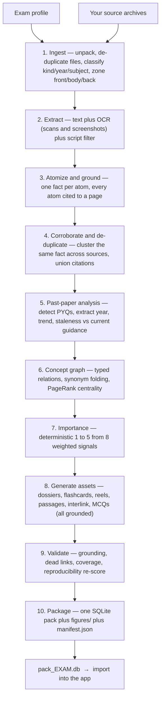

# StudyFeed

**A fully-offline, exam-agnostic study engine.** Point a compiler at your own study
material and it builds a single, self-describing **content pack**; a generic Android app
plays any pack — reading its exam name, subjects, tags and every question from the pack
itself. The shipped app reaches **no network** and runs **no background work** — not by
policy, but because the build refuses to produce an APK that could.

The app has no idea what MRCP is. Swap the pack and the *same binary* becomes a different
exam's app, with **zero code changes**. MRCP(UK) Part 1 is simply the first pack.

> **One idea holds the whole project together:** the **app is generic**, the **pack is the
> exam**. Everything exam-specific enters through a profile and leaves through the pack —
> never through code.

---

## Contents

- 👉 **[Start here — for clinicians (no coding needed)](#start-here--for-clinicians-no-coding-needed)** — if you just want to study
1. [How it works (the big picture)](#how-it-works-the-big-picture)
2. [Feed in your data — any source, any format](#1-feed-in-your-data--any-source-any-format)
3. [How the data is processed — the compiler](#2-how-the-data-is-processed--the-compiler)
4. [The app — what you study with](#3-the-app--what-you-study-with)
5. [One app, any exam — how packs interchange](#4-one-app-any-exam--how-packs-interchange)
6. [Repository layout](#repository-layout)
7. [Status](#status)
8. [Privacy, offline & licensing](#privacy-offline--licensing)
9. [Getting started](#getting-started)

---

## Start here — for clinicians (no coding needed)

StudyFeed runs **entirely on your phone**, offline. You give it a **study pack** — one file
holding questions, flashcards and topic pages — and it turns that into a smart,
spaced-repetition study feed. **You bring the pack; the app plays it.** There are two easy ways
in, and **neither needs any paid API keys.**

### 1 · Just use the app

1. Download the latest **`app-release.apk`** from this repo's **[Releases](../../releases)** and
   install it on an Android phone (allow *"install unknown apps"* the first time).
2. Open it → **Manage packs → Import** → pick a pack. The easy way to share one is a single
   **`.zip`** (just zip the pack folder — the app reads the pack straight out of it); a plain pack
   **folder** (`.db` + `manifest.json` + optional `figures/`) works too.
3. Study. Your progress stays **only on your device**; export it as a **`.zip`** any time and import
   that same zip on another phone to carry your history across devices.

*The app asks for zero permissions — no internet, no accounts, no tracking — and the build
itself refuses to produce an APK that could break that.*

### 2 · Build your own study set from **your** notes — with your AI assistant, no API key

Have your own revision notes, a question list, or a chapter you want turned into a study pack?
Open **Claude Code**, **Gemini CLI**, or **Codex** and paste the prompt below. It uses your
**existing AI subscription** to do the work — **no Anthropic API key and no per-use fees.** This
is best for **your own, focused material** (a topic, a set of MCQs, a chapter). For a whole
exam's worth of textbooks, see the heavier, API-key compiler in
[Getting started](#getting-started).

<details>
<summary><b>📋 Copy this prompt into your AI assistant</b></summary>

```
You are helping a doctor (not a programmer) turn their OWN study material into a StudyFeed
"content pack" that the StudyFeed Android app plays. Work INSIDE this cloned repository and use its
REAL files — never guess the format. Use YOUR OWN model/subscription for all AI work: do NOT ask
for or use an Anthropic API key.

REPO LAYOUT — read these BEFORE doing anything (the pack format is defined here; do not invent it):
  spec/SPEC.md              the pack contract (how the app reads a pack)
  spec/schema.sql           the exact SQLite schema — the SOURCE OF TRUTH for every table/column
  spec/manifest.schema.json the shape of manifest.json
  spec/SCORING.md           how the 1-5 importance ("star") rating works
  compiler/                 the real pack builder (Python); compiler/README.md has a
                            "Build without an API key - subscription mode" section
                            (compiler/studyfeed_compiler/llm_local.py)
  profiles/mrcp_part1.yaml  an example exam profile to copy
  app/                      the Android player (don't modify it)

STEP 1 - Read spec/SPEC.md, spec/schema.sql, spec/manifest.schema.json and spec/SCORING.md, then
tell me in plain words what a valid pack must contain (tables, a pack_manifest row, feed items).
Do not continue until you have actually read them.

STEP 2 - Ask me for my material (paste text, or point at my PDFs/notes) and which subjects it
covers. Keep it to MY OWN material - this is a personal, focused pack.

STEP 3 - Pick a build route and tell me which:
  (A) Rigorous (best if I have PDFs): use the COMPILER in subscription mode - put my files in
      compiler/sources/inbox/, copy profiles/mrcp_part1.yaml to a profile for my exam, run
      `unset ANTHROPIC_API_KEY`, then the compiler's extraction plus
      `python -m studyfeed_compiler.llm_local local-atomize` / `local-mcq` (subscription, no key),
      then the remaining pure-Python stages. See compiler/README.md.
  (B) Quick (a little pasted text): build a small pack DIRECTLY against spec/schema.sql.
  Either route: generate ONLY from my material (invent no facts); treat medical values literally -
  never reformat "5 * 10^9/L" or "> 140".

STEP 4 - Set each item's importance (the 1-5 STARS = the `importance` column, 1..5). Ask me which:
  - MANUAL:    I tell you which topics are high-yield; set those to 5, ordinary ones lower.
  - AUTOMATIC: score them per spec/SCORING.md (past-paper hits, repetition, my own emphasis...).
  Fill importance_score and importance_signals_json per the schema too.

STEP 5 - Produce the pack folder (`.db` matching spec/schema.sql + a matching manifest.json + any
figures), then ZIP that folder. The app imports a single `.zip` directly.

STEP 6 - Sanity-check the `.db` opens and row counts match the manifest, then tell me exactly where
the `.zip` is and how to import it: copy to phone -> StudyFeed -> Manage packs -> Import -> pick it.

Report what you actually did at each step, grounded in the files you read. If a step truly needs an
API key, say so plainly instead of pretending.
```

</details>

> **Who needs what:** *using the app* → nothing. *Building a personal pack* → just your AI-assistant
> subscription (the prompt above, or the compiler's **no-key subscription mode**, see
> [`compiler/README.md`](compiler/README.md)). *A large, rigorously-graded exam pack from many
> textbooks* → the full compiler with a paid API key, which is faster at that scale (see
> [Getting started](#getting-started)). The **finished app is always free and offline.**

---

## How it works (the big picture)

Three decoupled parts, joined **only** by the pack format:

```
  profiles/<exam>.yaml          ┌─────────────┐        pack_<EXAM>.db
  + your source archives  ───▶  │  COMPILER   │  ───▶  + figures/         ───▶  ┌──────────┐
  (compiler/sources/inbox/)     │  (Python)   │        + manifest.json          │   APP    │
                                └─────────────┘        (a "content pack")        │ (Android)│
                                                                                 └──────────┘
     WHAT + HOW to process         the machinery          the exam, frozen          the player
```

- **`profiles/<exam>.yaml`** — the only exam-specific file. Subjects, blueprint weights,
  source tiers, scoring knobs, synonyms, script rules, tags.
- **`compiler/`** — a resumable Python pipeline that turns raw PDFs into a structured,
  graded, cross-referenced SQLite pack. Exam-agnostic.
- **`app/`** — a generic Kotlin/Jetpack-Compose player. Exam-agnostic. Offline. Zero
  permissions.

Tokens (LLM cost) are spent **once, at build time**. The app that reaches a student's phone
has no API key, no network, no LLM.

---

## 1. Feed in your data — any source, any format

You do two things: **drop your archives in**, and **tell the profile what they are.** The
compiler does the rest — you never hand-unpack anything.

### Drop the archives

```
compiler/sources/inbox/          # the drop zone (gitignored — your content never enters git)
   Papers.zip                    # past papers
   Qbank.rar                     # a question bank
   Textbook.zip                  # textbooks / high-yield notes / references
   ...
```

Archives may be **`zip`, `rar`, `7z`, or `tar`**, **nested up to 8 deep** (an archive inside
an archive inside a folder — all fine). A password-protected or corrupt archive **stops and
asks**; it is never silently skipped.

### Every kind of page is handled

| Your material | How the compiler reads it |
|---|---|
| **Text PDFs** (real text layer) | Text + layout extracted directly — fast, local, **zero tokens**; a PDF is never sent to an LLM as an image |
| **Scanned / photographed PDFs** | **OCR** (Tesseract, English), low-confidence spans flagged |
| **App / website screenshots** | **OCR**, one screenshot = one page-unit |
| **Question banks** (with answer keys) | Parsed into structured best-of-five MCQs, with **per-item key trust** (a printed key is trusted differently from a recalled one) |
| **Textbooks / "pearls" / references** | Prose is **atomized** (below); embedded end-of-chapter & appendix question banks are parsed for MCQs too |
| **Highlights & annotations** | Digital highlights + **colour-mask OCR** of scanned highlighter marks become an "a human flagged this" emphasis signal |
| **Mixed scripts** | An allowlist keeps Latin, Greek and medical/mathematical notation; drops e.g. Arabic/Bengali spans; a predominantly non-Latin document **stops and asks** |

### Tell the profile what they are

A profile maps your filenames to a **kind** and a **provenance tier** (higher tier = more
trusted). This is the whole of the manual configuration:

```yaml
source_tiers:                       # trust prior by provenance; per-file classify refines it
  past_papers: {tier: 1, tier_weight: 1.00}
  qbanks:      {tier: 2, tier_weight: 0.75}
  textbooks:   {tier: 3, tier_weight: 0.60}
  references:  {tier: 4, tier_weight: 0.45}

drops:                              # globs matched against YOUR dropped filenames
  - {glob: "Papers*.zip",   default_kinds: [past_paper], require: year_per_file}
  - {glob: "Qbank*.rar",    default_kinds: [qbank], subject_from: filename}
  - {glob: "Textbook*.zip", default_kinds: [textbook, pearls, reference], classify: per_file}
```

Duplicate files (the same PDF loose *and* inside a zip) are collapsed automatically when
byte-identical, and **flagged for a human decision** when only fuzzily similar — the compiler
never silently merges two editions of one book, or the same file claimed at two different
trust tiers.

---

## 2. How the data is processed — the compiler

This is the part that makes StudyFeed more than a flashcard shell. A single resumable
command (`uv run python -m studyfeed_compiler.run`) drives a **~14-stage pipeline** that turns
a pile of PDFs into a graded, cross-linked, exam-ready knowledge base. Every stage
checkpoints to disk, so a build that stops can always resume.



What each stage is really doing, and why it matters:

- **Atomize & ground.** Prose is broken into *atoms* — one fact each — and **every atom
  carries a citation to the exact source page.** A hard **grounding gate** quarantines
  anything that can't be traced back to its cited page. Nothing ungrounded ever ships.
- **Corroborate.** The same fact asked across several independent sources ("asked at multiple
  sites") is detected and counted, and citations are **unioned — a source is never dropped.**
- **Past papers.** Past-paper items are detected, their **year** extracted, a per-topic
  **trend** computed, and any key that current guidance may have overtaken is **flagged, never
  overwritten** — the app shows "key disputed" rather than pretending to know better.
- **Concept graph.** Facts become a typed graph — *subject → relation → object* — with
  synonyms folded so **one entity is one node**, then every concept is ranked by **PageRank
  centrality**. (The first pack: **37,795 concepts, 67,795 typed edges.**)
- **Importance (1–5), deterministically.** Not an LLM's gut feeling — a transparent, auditable
  formula over **eight weighted signals**: past-paper weight, corroboration, frequency, source
  emphasis, blueprint fit, centrality, source tier, and recency trend. The exact weights live
  in [`spec/SCORING.md`](spec/SCORING.md) and travel inside every pack.
- **Generate assets.** Pre-built **topic dossiers** (one long, grounded page per concept),
  plus **flashcards, reels, passages with quiz-backs, interlink questions** (that test an edge
  of the concept graph), and generated **best-of-five MCQs** — each one grounded to its source
  atom before it is allowed in.
- **Validate & package.** A deterministic audit (grounding, dead links, blueprint coverage,
  importance distribution) and then packaging into a single SQLite file that conforms to a
  published schema.

### The guarantees that make a pack trustworthy

- **Grounded, not hallucinated.** Every atom and every generated asset is verified against its
  cited page or quarantined. Grounding is a hard gate, not a nicety.
- **Reproducible by design.** Build the same inputs twice → **byte-identical content keys.**
  Every item has a content-derived *stable key*, so your saved progress survives a pack
  rebuild — add a new source and existing keys don't move.
- **Cost is spent once.** The heavy language-model work runs through the **Anthropic Batch
  API** on the build machine. The shipped app has no network and no key.
- **Correctable.** A web-verified factual error in a source can be excluded by content key in
  the profile (`data_corrections`), and stays excluded across every future rebuild.

### What one real pack looks like (MRCP(UK) Part 1)

| | |
|---|---|
| Source works ingested | **99** |
| Grounded, cited atoms | **86,698** (131,906 citations) |
| Concept graph | **37,795 concepts · 67,795 typed edges** |
| MCQs | **14,455** (incl. detected past-paper items) |
| Flashcards · reels | **9,507 · 3,000** |
| Passages (+ quiz-backs) · interlink questions | **2,997 · 2,998** |
| Topic dossiers | **8,194** |
| Figures | **1,121** |
| **Playable feed items** | **32,957** |
| Subjects | **16** (blueprint-weighted) |

---

## 3. The app — what you study with

A single-screen Android app (no service, no receiver, no provider — ever) that turns a pack
into an endless, intelligent study session.

- **An intelligent study feed.** A vertical, swipeable feed of five card types, all drawn from
  the pack:
  - **MCQ** — best-of-five; pick an option → inline answer, explanation, and a *why-wrong* for
    each distractor.
  - **Flashcard** — tap to flip; Anki-style cloze deletions supported.
  - **Reel** — a one-hook, swipeable fact card.
  - **Passage** — a short read with a quiz-back that lands a few cards later.
  - **Interlink** — a question that tests a *link* between two concepts.
- **Spaced repetition that actually schedules (FSRS-6).** Every answer updates the card's
  memory state; the feed leads with what's **due**, drips in **new** cards paced to an editable
  **exam deadline**, and keeps **variety** so you're never fed ten of the same thing.
- **Topic dossiers (the Library).** Search or browse thousands of pre-built, cross-subject
  "read up on X" pages — each grounded, with its figures, related questions and concept-map
  link.
- **A walkable concept map.** Start at any concept and walk its typed relationships as an
  interactive graph; node size encodes centrality, colour encodes importance; "quiz me on
  these links" turns the local graph into interlink questions.
- **Progress, mistakes & mastery.** Per-subject mastery bars, an FSRS forgetting curve, a
  mistake log you can **tag** (careless / knowledge gap / mixed-up / guessed / revisit) and
  **re-drill** until resolved, plus streak and XP.
- **A home dashboard.** Due-today, new-left, today's target, streak and per-subject progress —
  the hub every screen returns to.
- **Named sessions, a mock exam & more.** Save resumable, filtered study runs that remember your
  place; sit a timed, **blueprint-weighted mock exam** with a scored per-subject report; one-tap
  **weak-spot drills** + **leech** detection; **custom decks**; and star topics *and individual
  lines* in the Library, with past-paper / 5★ lines auto-highlighted.
- **Offline & private by construction.** Zero permissions, zero network, zero background work,
  AMOLED true-black. The build *enforces* this: an APK that gains an INTERNET permission, any
  background component, or a networking dependency **cannot be produced** (see
  [`app/README.md`](app/README.md)).
- **Your progress is yours.** Content and progress live in **two separate databases**, so
  re-importing a pack **never wipes your history**; you can export/import your progress as a
  ZIP.

---

## 4. One app, any exam — how packs interchange

The app **knows only the pack contract** ([`spec/SPEC.md`](spec/SPEC.md)); it learns
everything exam-specific by reading a pack at runtime. If anything in the app reads as
MRCP-specific, that's a bug.

**Adding a whole new exam takes no code:**

1. Copy `profiles/mrcp_part1.yaml` → `profiles/<your_exam>.yaml`; edit the taxonomy, tiers,
   weights, tags, synonyms and script rules.
2. Drop that exam's archives into `compiler/sources/inbox/`.
3. Re-run the compiler → `pack_<YOUR_EXAM>.db` + `figures/` + `manifest.json`.
4. Import it in the app → it configures its exam label, subject chips, tag chips and scoring
   from the **manifest**. **Same app binary.**

How the swap stays safe:

- **Self-describing packs.** One `pack_manifest` row (mirrored by `manifest.json`) carries the
  exam name, subjects, tags, importance weights and feature flags. The UI renders itself from
  that.
- **Capabilities are per-pack, at runtime.** A trimmed pack (say, no concept map) simply offers
  less — the app detects what each pack actually contains and hides the rest. No feature is
  hard-coded on.
- **Two versions, guarded.** A pack declares its **schema version** (the DB shape) and its
  **content version**. The app **refuses a newer schema** rather than crash, and still loads a
  compatible older one. Stable ids are a contract, so re-importing a rebuilt pack keeps your
  progress aligned.
- **Many packs, one app.** Installed packs are discovered from the filesystem (never a list
  that can drift); each is labelled from its own manifest; progress is namespaced per
  `exam_code`, so you can **switch exams** and keep separate histories.

MRCP Part 2, PLAB, USMLE, a law bar exam, a language test — anything that fits a
"weighted-subjects, graded-items" shape can be a pack. The engine doesn't care.

---

## Repository layout

```
spec/         the pack CONTRACT — schema.sql (source of truth) + SPEC.md + manifest.schema.json + SCORING.md
profiles/     one YAML per exam; everything exam-specific lives here, never in code
compiler/     the Python pipeline (studyfeed_compiler/) — run.py is the resumable stage DAG
app/          the generic Kotlin/Compose player (offline, zero-permission)
.claude/      INDEX.md (the codebase map) + PLAYBOOK.md (verified notes) + build/session tooling
```

The **[`.claude/INDEX.md`](.claude/INDEX.md)** file is a one-line-per-file map of the whole
codebase — the fastest way in.

---

## Status

- **Compiler — complete.** The full pipeline runs end-to-end and has produced the first pack
  (MRCP Part 1: 32,957 playable items), reproducibly.
- **App — feature-complete (A0–A7).** Pack import + the two-DB model (a re-import never wipes
  progress), the study feed (five item types, FSRS-6, an ordering engine), the topic Library with
  per-line stars, the concept map, a data-rich Progress screen, named resumable **sessions**, a
  **mock exam**, weak-spot drills and custom decks — all built and verified on-device. Remaining:
  release-APK signing polish.

---

## Privacy, offline & licensing

- **The shipped app is offline by construction** — no network, no background execution, no
  telemetry, no accounts. Everything renders from the imported pack. This is enforced by the
  build, not left to discipline.
- **This repository is the *tooling*** — the compiler and the app. It does **not** contain, and
  never distributes, any exam content. **Content packs are built privately, from material you
  own or are licensed to use**, and are gitignored end to end (source archives, the built DB,
  and extracted figures never enter git). Respect the copyright and terms of your own sources.

---

## Getting started

**Build a pack** (needs [uv](https://docs.astral.sh/uv/); an `ANTHROPIC_API_KEY` in
`compiler/.env` for the LLM stages):

```bash
cd compiler
uv sync
uv run python -m studyfeed_compiler.run --list     # show the stages + resume state (offline, free)
uv run python -m studyfeed_compiler.run            # build / resume the pack
```

**Build the app** — see **[`app/README.md`](app/README.md)** for the toolchain, the offline
guard, signing, and install steps.

**Understand the contract first** — **[`spec/SPEC.md`](spec/SPEC.md)** is the seam between the
two, and the shortest path to understanding the whole design.
